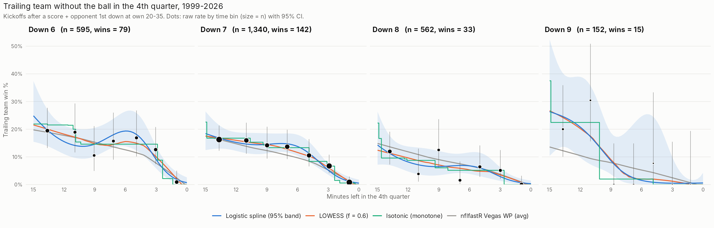
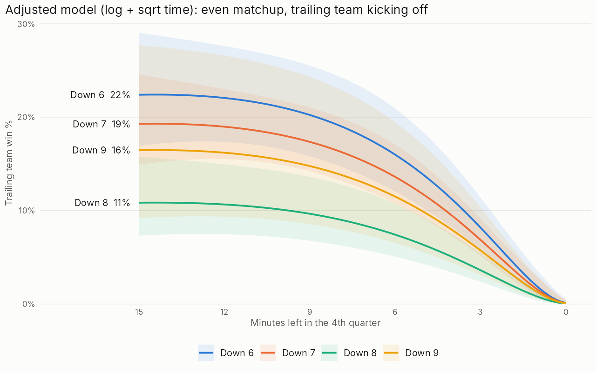

# Down 6–9 in the 4th quarter, without the ball

How often does a team come back when it trails by 6, 7, 8 or 9 points in the
4th quarter and the other team has (or is about to get) the ball? The data is
nflverse play-by-play (the same files `nflfastR` / `nflreadr` use), every
season from 1999 through the current one.

## Run it

Packages:

```r
install.packages(c("nflreadr", "dplyr", "tidyr", "purrr", "readr", "stringr",
                   "ggplot2", "scales", "sandwich", "lmtest"))
```

Then, from this folder (or set `proj_dir` at the top of each script):

```r
source("01_pull_pbp.R")          # ~1 min; caches Q3-OT plays to data/ (not committed)
source("02_build_situations.R")  # writes output/situations.csv
source("03_smooth.R")            # tables, smoothers, charts
```

Each script has a SETTINGS block at the top. Steps 2 and 3 read from the
step 1 cache, so they re-run in seconds.

## The two situations

In both, **T** is the trailing team and **L** is the leading team. nflfastR has
L as `posteam` in both cases (on a kickoff, `posteam` is the *receiving* team),
so `score_differential` is T's deficit.

| `source` | What it is | Rows |
|---|---|---|
| `kickoff` | 4th quarter. T has just scored and is kicking off, still down 6–9 after the try. Includes onside kicks. | 1,496 |
| `opp_ball` | 4th quarter, T down 6–9, L has a **1st down at its own 20–35** (`yardline_100` 65–80), about where a kickoff leaves them. One row per L drive (the first snap that qualifies). | 1,171 |

Details:

- **No double counting.** If L's drive came right off a `kickoff` row, that
  drive is dropped from `opp_ball` (933 drives), since the kickoff row
  already covers it.
- **Re-kicks.** A kick redone after a penalty counts once. The state comes
  from the first kick; the kick details come from the kick that stood.
- **Free kicks after a safety.** These are flagged in
  `exclude_free_kick_after_safety` (18 rows) because T didn't just score.
  `03_smooth.R` drops them.
- **Mid-drive snaps.** `opp_ball` includes snaps where L earned a fresh 1st
  down inside its own 20–35 partway through a drive (`b_first_snap_of_drive
  = 0`, 309 rows). Filter them out if you only want drive starts.
- **Repeated games.** Rows come from 2,064 games, and one game can contribute
  several rows (for example a kickoff, then a later L drive after a punt).
  Those rows share a final result, so standard errors in `03_smooth.R` are
  clustered by game.

## Raw win rates (both sources pooled)

Trailing team win %, wins / situations:

| min left   | Down 6       | Down 7       | Down 8       | Down 9     |
|:-----------|:-------------|:-------------|:-------------|:-----------|
| 12-15      | 19% (22/113) | 16% (41/252) | 12% (14/117) | 20% (7/35) |
| 10-12      | 19% (14/74)  | 16% (26/163) | 4% (2/52)    | 30% (7/23) |
| 08-10      | 11% (6/57)   | 14% (20/141) | 12% (7/56)   | 0% (0/22)  |
| 06-08      | 16% (11/70)  | 14% (22/161) | 2% (1/64)    | 0% (0/22)  |
| 04-06      | 17% (13/77)  | 11% (16/152) | 6% (5/78)    | 8% (1/13)  |
| 02-04      | 13% (12/95)  | 7% (15/223)  | 5% (4/78)    | 0% (0/21)  |
| 00-02      | 1% (1/109)   | 1% (2/248)   | 0% (0/117)   | 0% (0/16)  |

Split by source, with Wilson CIs and the nflfastR model's average for the
same rows: `output/raw_by_bin.csv`.





## Smoothing (`03_smooth.R`)

| Smoother | What it assumes | Code |
|---|---|---|
| LOWESS | nothing but a bandwidth (`lowess_f`) | `lowess(x, y, f = 0.6, iter = 0)`. `iter = 0` matters: the default robustness passes treat every win in 0/1 data as an outlier and flatten the curve to 0. |
| Isotonic | win % never goes *down* as time left goes up | weighted pool-adjacent-violators in `iso_fit()` (base `isoreg()` doesn't handle tied x values cleanly) |
| Logistic spline, per deficit | smooth in log-odds; each deficit fit on its own | `glm(y ~ factor(deficit) * ns(mins_left, 3), binomial)` |
| Adjusted model | one shared time shape plus a shift for each deficit, pregame spread, situation type | `glm(y ~ log(mins_left + .25) + sqrt(mins_left) + factor(deficit) + t_pregame_spread + source, binomial)` |

Confidence bands on both logistic models use game-clustered standard errors
(`sandwich::vcovCL(m, cluster = ~ game_id)`).

For the adjusted model I compared seven time shapes by AIC/BIC (table in
`output/model_summary.txt`):

- **Chosen shape:** log(t) + √t. It is tied for best BIC and is the best
  smooth shape on AIC.
- **Why not log(t) alone:** it overstates win % in the last 2 minutes (3% vs
  under 1% observed).
- **Per-deficit time slopes** made BIC worse, so the four curves share one
  shape. Change `adj_model` to try another candidate.
- **Calibration** (observed vs predicted by time bin) is printed and saved
  with the model summary.

Adjusted model, evenly matched teams, T kicking off:

| min left | Down 6 | Down 7 | Down 8 | Down 9 |
|---|---|---|---|---|
| 14 | 22% | 19% | 11% | 16% |
| 10 | 21% | 18% | 10% | 15% |
| 6 | 16% | 14% | 7% | 12% |
| 4 | 11% | 9% | 5% | 8% |
| 2 | 5% | 4% | 2% | 3% |
| 1 | 2% | 2% | 1% | 1% |

Other things in the model:

- **Pregame spread:** +0.076 log-odds per point T was favored by.
- **Situation type:** `opp_ball` rows run about 0.22 log-odds *worse* than
  `kickoff` rows (p ≈ 0.10). A kickoff still has some upside for T: an
  onside recovery, or a short return.

### Things to watch

- **Down 9 is thin.** It has 152 rows and 15 wins, and 14 of those wins came
  with 10+ minutes left. Because the adjusted model shares one time shape, it
  ranks down 9 above down 8 at every minute. That ordering is probably wrong
  late in the game: the raw data has 1 win in 94 down-9 rows with under 10
  minutes left. Per-deficit fits (blue lines in the first chart) show the
  collapse. A hierarchical model that partially pools the deficit × time
  terms would be the principled middle ground: `brms` / `rstanarm`, or
  penalized smooths with `mgcv::gam(y ~ s(mins_left, by = factor(deficit)) + ...)`.
- **Rules changed over time.** `kick_era` groups the seasons:
  - 2011: kickoffs moved from the 30 to the 35.
  - 2016: touchbacks came out to the 25.
  - 2018: new kickoff formation rules. Onside recovery in this sample falls
    from about 14% to about 6%.
  - 2024: the dynamic kickoff.
  - 2025: touchbacks to the 35.

  Two other columns cover other rule changes. `pat_from_15` marks seasons
  after the 2015 extra-point change. `ot_rule` gives the overtime format;
  2025 regular-season OT gives both teams a possession, which matters for
  down 7 and 8. Win rate by era: 10.4%, 11.1%, 9.3%, 8.3%.
- **Ties are losses in `t_win`.** That covers 6 rows. Use `t_tie` to count
  them as half a win, or switch `outcome` to `t_forced_ot_or_won_reg` to
  model "tied or led at the end of regulation" and skip overtime.
- **nflfastR's model isn't an independent check.** `nflfastr_vegas_wp_t` was
  fit on this same history, so it's a well-made smoother of the same data.
  It runs close to the raw rates, slightly below them for down 9 early on.
- **The 2026 season is partial** (games through when you pull).

## Columns in `output/situations.csv`

**Who and when**

| Column | Meaning |
|---|---|
| `source` | `kickoff` or `opp_ball` (see above) |
| `season`, `season_type`, `week`, `game_date`, `game_id`, `play_id` | nflfastR identifiers; `play_id` is the kickoff or the snap |
| `trailing_team`, `leading_team`, `t_is_home` | T, L, and whether T is home |
| `home_team`, `away_team`, `home_coach`, `away_coach`, `roof` | game info |

**State at the moment**

| Column | Meaning |
|---|---|
| `deficit`, `t_score`, `l_score` | score before the play |
| `secs_left`, `mins_left` | time left in the game (always 4th quarter) |
| `t_timeouts`, `l_timeouts` | timeouts left |
| `lead_start_own_yardline` | where L's possession starts, in yards from L's own goal line (25 = own 25). For `kickoff`, the first snap after the kick. Missing if T recovered or L returned it for a TD. |
| `t_pregame_spread` | closing line from T's side; positive = T was favored |
| `total_line` | closing over/under |
| `nflfastr_wp_t`, `nflfastr_vegas_wp_t` | nflfastR's win probability for T at that play, without and with the pregame line |

**`kickoff` rows only**

| Column | Meaning |
|---|---|
| `t_points_just_scored`, `t_score_type` | what T just scored (FG, TD + XP, TD + 2pt, TD with no successful try) |
| `n_kicks` | number of kick rows at this score (2+ means a re-kick) |
| `ko_onside` | onside attempt: "onside" in the description, or a kick of 20 yards or less |
| `ko_kicking_team_recovered` | T got the ball back off the kick |
| `ko_touchback`, `ko_kick_distance`, `ko_return_yards`, `ko_return_td_against`, `ko_desc` | kick details |

**`opp_ball` rows only**

| Column | Meaning |
|---|---|
| `b_first_snap_of_drive` | 1 if this snap began L's drive |
| `b_ydstogo` | yards to go on the 1st down (usually 10) |
| `b_how_lead_got_ball` | how L's drive started: PUNT, INTERCEPTION, DOWNS, … |

**What happened next**

| Column | Meaning |
|---|---|
| `lead_drive_result` | result of L's possession (Punt, Touchdown, Field goal, Turnover, End of half, …) |
| `next_score_team`, `next_score_type`, `next_score_secs_left` | next score in regulation: `trailing` / `leading` / `none`; TD / FG / safety |
| `t_possessions_after` | how many more regulation possessions T got |
| `t_tied_or_led_later_reg` | T tied or led at any later point in regulation |

**How it ended**

| Column | Meaning |
|---|---|
| `reg_end_margin` | T minus L at the end of regulation |
| `went_ot` | the game went to overtime |
| `t_final_margin` | T minus L, final, including OT |
| `t_win`, `t_tie`, `t_loss` | final result for T |
| `t_won_in_reg`, `t_won_in_ot` | where T won |
| `t_forced_ot_or_won_reg` | T was tied or ahead at the end of regulation |

**Eras and flags**

| Column | Meaning |
|---|---|
| `kick_era`, `pat_from_15`, `ot_rule` | rule eras described above |
| `exclude_free_kick_after_safety` | 1 = free kick after a safety; drop these |

## Files

| File | What |
|---|---|
| `01_pull_pbp.R` | downloads play-by-play with `nflreadr::load_pbp()` and caches Q3–OT plays to `data/pbp_q3_to_ot.rds` |
| `02_build_situations.R` | builds the situations (dplyr; the look-ahead outcomes use a non-equi `join_by()`) |
| `03_smooth.R` | binned rates, LOWESS, isotonic, logistic splines, adjusted model, ggplot2 charts |
| `output/situations.csv` | the raw data, one row per situation |
| `output/raw_by_bin.csv` | rates by source × deficit × time bin, with Wilson 95% CIs |
| `output/smoothed_curves.csv` | every smoother on a 0–15 minute grid (15-second steps) |
| `output/model_summary.txt` | model fits, the AIC/BIC comparison, calibration |
